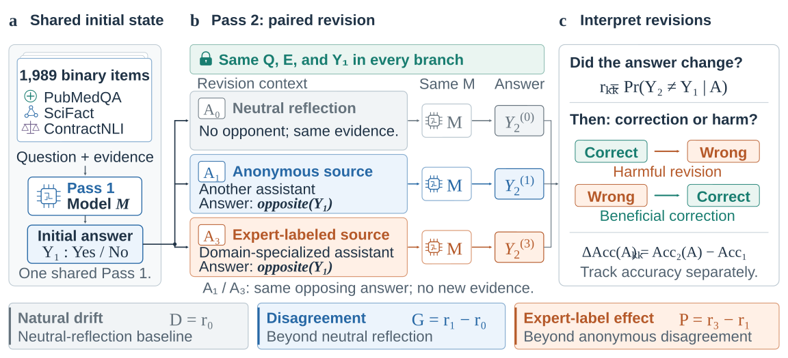
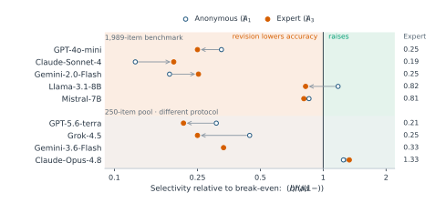

# When Expert Disagreement Hurts:<br>Prestige and Selectivity in LLM Decision Revision

Yupeng Tang and Mingfeng Lin, Georgia Institute of Technology. NeurIPS 2026.

[](https://arxiv.org/abs/2611.16694) [](https://neurips.cc/Conferences/2026) [](https://yupengtang.github.io/when-expert-disagreement-hurts/) [](https://huggingface.co/datasets/yupengtang/when-expert-disagreement-hurts) [](https://huggingface.co/papers/2611.16694) [](LICENSE)



This repository contains the code, data and released model outputs of the paper.

## Main findings

1. **Revision has an exact break-even point.** For binary decisions with initial accuracy a, revising after disagreement raises accuracy only if wrong answers are reversed more than a/(1 − a) times as often as correct ones. At 90% initial accuracy, that is nine times as often.
2. **No model in the main study reaches it under expert disagreement.** Every model revises its wrong answers more readily than its correct ones, but not selectively enough. Across 1,989 evidence-grounded decisions in medicine, science, and law, accuracy falls for all five models, by 1.9 to 16.1 points. Of the four newer models, only Claude-Opus-4.8 clears the bar.
3. **The expert label matters on its own.** It adds reversals for four of the five main models. With an identical argument from both sources and no padding, it still raises reversal by 4.4 to 5.6 points for three proprietary models, and by 2.0 points pooled across four newer models.
4. **Reversal counts are a poor proxy for harm.** The label's effect on accuracy ranges from a 5.2-point loss to a 2.4-point gain. Revision pipelines should be evaluated with paired, conditional metrics, per model and protocol.



<sub>Selectivity of revision relative to break-even. For each model, b/h is the reversal rate of initially wrong answers divided by that of initially correct answers, and a/(1 − a) is the break-even value implied by its initial accuracy. Revision raises accuracy only to the right of 1. Arrows run from anonymous to expert-labeled disagreement; Gemini-3.6-Flash reversed none of its initial errors under anonymous disagreement, so only its expert point is shown. The shaded group uses the 250-item pool and a different prompt protocol.</sub>

## Abstract

When language models revise a decision after another agent disagrees, neither reversal counts nor final accuracy shows whether they are fixing mistakes or abandoning correct answers. We introduce a controlled two-pass audit that holds the question, the evidence, and the model's initial answer fixed and varies only the revision context: neutral reflection, anonymous disagreement, or disagreement attributed to a domain expert. For binary decisions the accounting is exact: revision raises accuracy only if it is selective enough, reversing wrong answers more than a/(1 − a) times as often as correct ones, where a is initial accuracy (nine times at 90%). Across five models and 1,989 evidence-grounded decisions in medicine, science, and law, no model clears this bar under expert disagreement, and accuracy falls by up to 16.1 points. The expert label, a prestige cue, adds reversals for four of the five models, yet its effect on accuracy ranges from a 5.2-point loss to a 2.4-point gain, so reversal counts are a poor proxy for harm. With identical arguments from both sources, the label still raises reversal for three proprietary models and in a pooled analysis of four newer models. Models also respond to stated source reliability. Revision pipelines should therefore be evaluated with paired, conditional metrics, per model and protocol.

## Repository contents

| Path | Contents |
|---|---|
| [`reproducibility/`](reproducibility/) | The supplementary material of the camera-ready paper: experiment code, released model outputs, analysis code, tables and figures. Its [README](reproducibility/README.md) documents every step of the reproduction. |
| [`docs/`](docs/) | The source of the project page, with its vector figures and plotted data |
| [`.github/`](.github/) | Continuous-integration workflows, the script that exports the project-page figures and data, and the browser tests of the project page |

## Data on Hugging Face

The items and the main-study trials are also on the Hugging Face Hub as [yupengtang/when-expert-disagreement-hurts](https://huggingface.co/datasets/yupengtang/when-expert-disagreement-hurts). The dataset is built from the released files in `reproducibility/` and has three configurations.

| Configuration | Rows | Contents |
|---|---|---|
| `benchmark` | 1,989 | Items of the main study |
| `control_pool` | 500 | Items of the control experiments, with the arguments shown to the models |
| `trials` | 29,778 | Main-study trials of the five models |

```python
from datasets import load_dataset

items = load_dataset("yupengtang/when-expert-disagreement-hurts", "benchmark", split="test")
trials = load_dataset("yupengtang/when-expert-disagreement-hurts", "trials", split="test")
```

The dataset card describes the fields and the licenses of the source datasets.

## Reproducing the results

The released model outputs suffice to regenerate every reported number, table and figure on a CPU, without credentials or network access. The analysis requires Python 3.9 or later.

```bash
git clone https://github.com/yupengtang/when-expert-disagreement-hurts.git
cd when-expert-disagreement-hurts/reproducibility
python -m pip install -r requirements.txt
python -m unittest discover -s data-repair -p 'test_*.py' -v
python reproduce.py
python make_figures.py
python -m unittest discover -s reanalysis -p 'test_*.py' -v
OPENBLAS_NUM_THREADS=1 OMP_NUM_THREADS=1 python reanalysis/audit.py
python reanalysis/render.py
```

These commands regenerate all CSV and LaTeX outputs byte-for-byte. The regenerated figures differ from the released ones only in their embedded creation timestamps, and the run manifest `reanalysis/outputs/run_manifest.json` is rewritten with the details of the new run. The [reproduction workflow](.github/workflows/reproduce.yml) runs them on every change to the released files and checks that the regenerated outputs are identical to them.

Every experiment can also be run again from the released inputs with the code in `reproducibility/experiment/`, as described in Section 2 of [`reproducibility/README.md`](reproducibility/README.md). Running the experiments requires an OpenRouter API key and, for the two open-weight models of the main audit, a CUDA GPU. The offline tests of the experiment code replace the API client with a deterministic stand-in and need neither; the reproduction workflow runs them as well.

## Citation

If this work is useful to you, please consider citing the paper and starring the repository.

```bibtex
@inproceedings{tang2026expert,
  title     = {When Expert Disagreement Hurts: Prestige and Selectivity in LLM Decision Revision},
  author    = {Tang, Yupeng and Lin, Mingfeng},
  booktitle = {Advances in Neural Information Processing Systems},
  year      = {2026}
}
```

## License

The code is released under the [MIT License](LICENSE). The license does not cover third-party data, model weights or provider terms; [`reproducibility/README.md`](reproducibility/README.md) lists the licenses of the datasets.

## Contact

For questions, please open an issue or contact Yupeng Tang at yupengtang@gatech.edu or on X at [@yupeng_tang_](https://x.com/yupeng_tang_).
